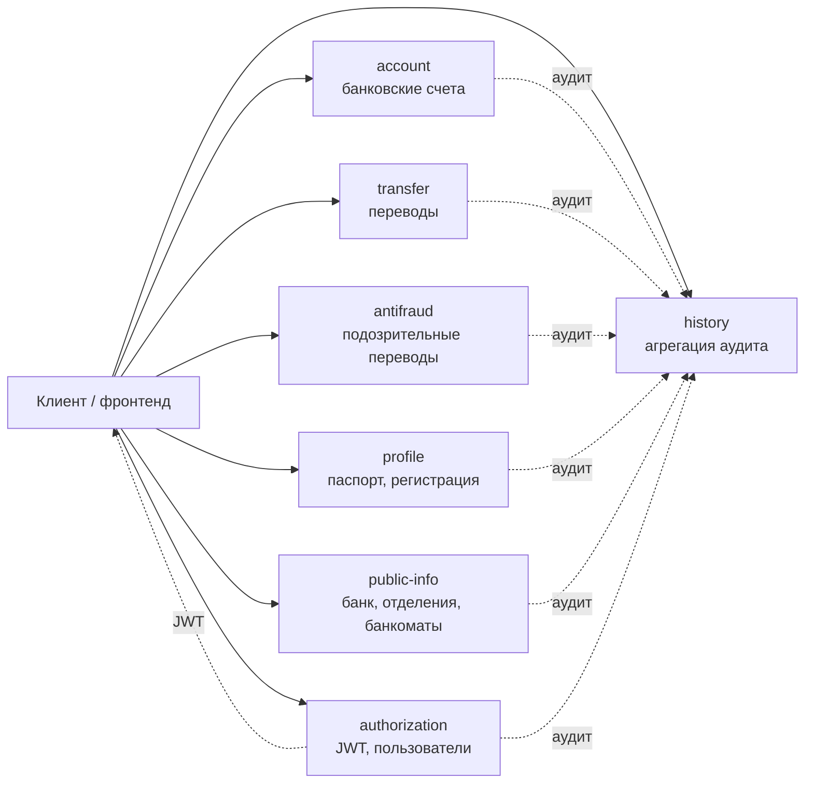
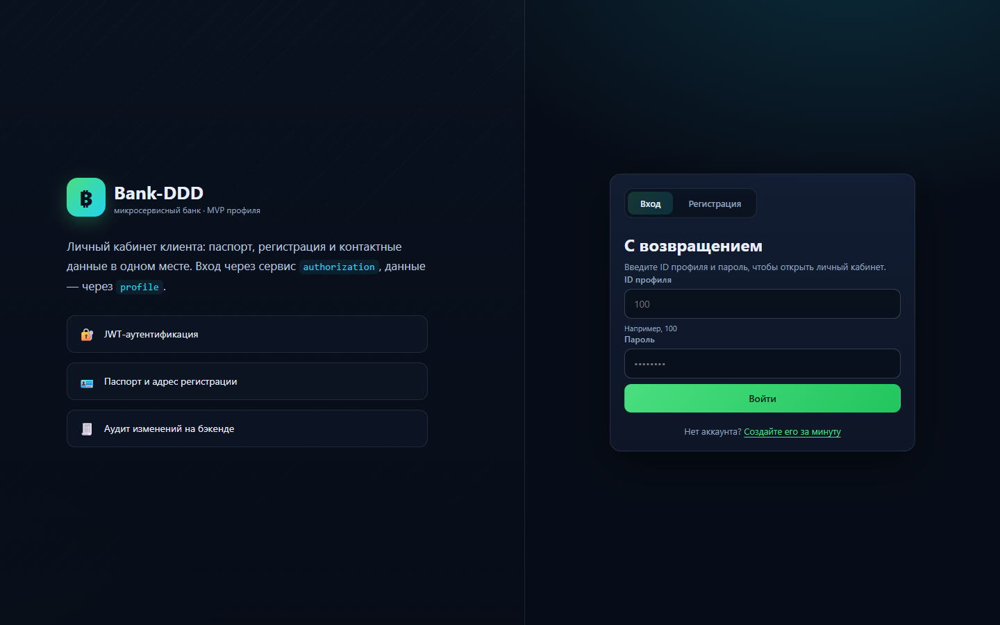
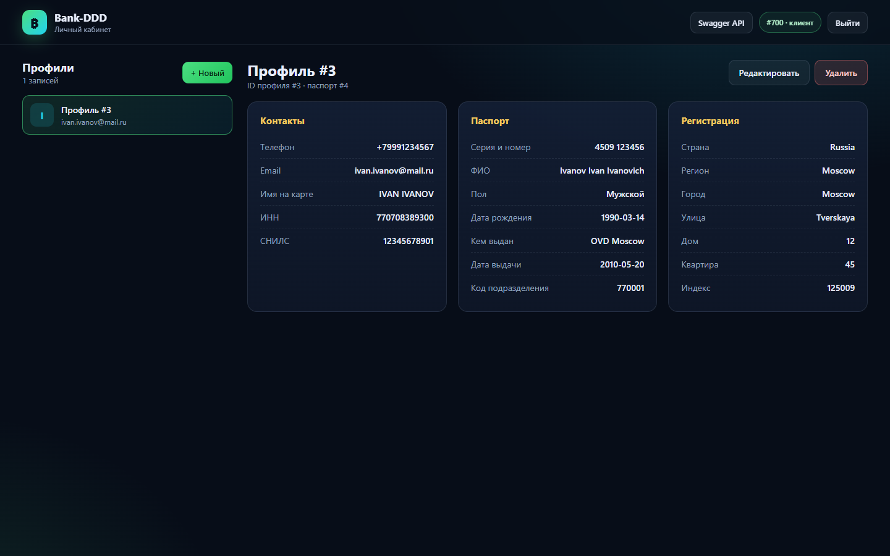
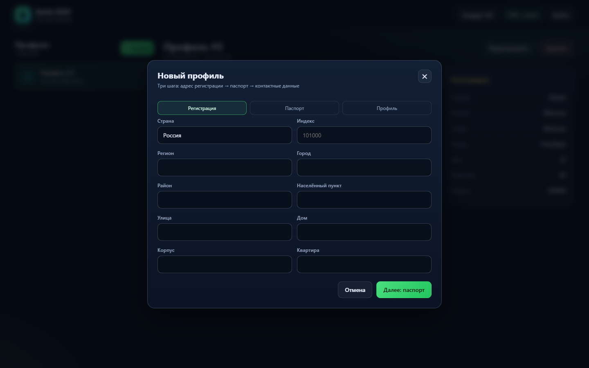

# 🏦 Bank-DDD — банковский backend на микросервисах


> Учебный pet-проект: банковская система, разбитая на семь микросервисов.
> Цель — пройти полный путь от схемы БД до работающего REST API: DDD-разделение,
> слоистая архитектура, миграции, JWT, аудит через AOP и честные тесты.

---

## 👋 Привет, это мой проект

Меня зовут **Даниил** ([@Daniil2022Ri](https://github.com/Daniil2022Ri)). Это мой pet-проект,
в котором я собираю банковский backend так, как делал бы его «по-взрослому»: не один монолит
на все случаи жизни, а набор небольших сервисов, у каждого своя зона ответственности, своя
схема в PostgreSQL и свой набор тестов.

Мне было интересно не просто «сделать CRUD», а пройти весь путь:

- спроектировать домен по готовой схеме БД (Liquibase-чейнджсеты — это моё ТЗ);
- разложить код по слоям и не превратить сервис в свалку;
- добавить аудит изменений так, чтобы он не протекал в бизнес-логику;
- покрыть всё unit-, web- и интеграционными тестами на реальной СУБД;
- и получить проект, который запускается одной командой и не стыдно показать.

---

## 💡 В чём смысл

Банк — это классический пример домена, где важны границы: клиент, его документы, счёт,
перевод, антифрод и история операций — это разные области, и смешивать их в одном сервисе
больно. Поэтому проект разбит на **bounded contexts**, и каждый сервис отвечает за свою часть:



Жизненный сценарий выглядит так:

1. клиент регистрируется и логинится — **authorization** выдаёт JWT;
2. заполняет профиль: паспорт, регистрация, фактический адрес — **profile**;
3. получает банковский счёт — **account**;
4. делает перевод по счёту, карте или телефону — **transfer**;
5. **antifraud** помечает подозрительные переводы и блокирует их;
6. **history** собирает аудит-записи всех сервисов и отдаёт агрегированную историю;
7. **public-info** хранит открытые данные банка: реквизиты, отделения, банкоматы, лицензии.

Такой проект — отличный тренажёр: здесь есть и чистые CRUD-сервисы, и безопасность,
и межсервисные ссылки, и работа с деньгами, и аудит.

---

## 📸 Скриншоты

**Вход и регистрация** — JWT через `authorization`:



**Личный кабинет** — список профилей и карточка клиента с паспортом и адресом:



**Создание профиля** — визард из трёх шагов:



---

## 🏗 Архитектура

Семь независимых Spring Boot приложений, каждое со своей схемой в одной базе PostgreSQL
(в реальном проде — свои базы, для пет-проекта удобнее одна):

| Сервис | Порт | Context path | Схема БД | Ответственность | Тесты |
|---|---|---|---|---|---|
| `account` | 8085 | `/api/account` | `account` | банковские счета | 29 |
| `antifraud` | 8086 | `/api/anti-fraud` | `anti_fraud` | подозрительные переводы | 37 |
| `authorization` | 8087 | `/api/authorization` | `auth` | пользователи, роли, JWT | 35 |
| `history` | 8088 | `/api/history` | `history` | история и агрегация аудита | 19 |
| `profile` | 8089 | `/api/profile` | `profile` | паспорт, регистрации, профиль | 42 |
| `public-info` | 8091 | `/api/public-info` | `public_info` | банк, отделения, банкоматы | 21 |
| `transfer` | 8092 | `/api/transfer` | `transfer` | переводы по счёту/карте/телефону | 24 |

У каждого сервиса отдельный порт для Actuator (`8185`, `8186`, `8187`, `8188`, `8189`, `8190`, `8191`),
так что метрики и health-check не мешают бизнес-API.

---

## 🧱 Как устроен код

Внутри каждого сервиса — одинаковая, предсказуемая слоистая структура:

```
controller  →  service (interface + impl)  →  repository  →  entity
                    ↓            ↑
                   dto       mapper (MapStruct)
```

- **entity** — JPA-сущности, один-в-один со схемой из Liquibase;
- **dto** — контракт API с bean-валидацией (`@NotNull`, `@Positive`, `@Email`, `@Digits`…);
- **mapper** — MapStruct, генерирует маппинг на этапе компиляции;
- **repository** — Spring Data JPA, проверки уникальности и существования;
- **service** — бизнес-логика, `@Transactional`, проверки ссылок и доменные исключения;
- **controller** — тонкий REST-слой, только приём запроса и вызов сервиса;
- **exception** — `EntityNotFoundException` (404), конфликты (409), бизнес-валидация (400)
  и единый `ErrorResponse` через `@RestControllerAdvice`;
- **audit** — AOP-аспект, который перехватывает `create`/`update` и пишет в `audit`
  старое и новое состояние сущности в JSON, не засоряя сервисный слой;
- **config** — OpenAPI/Swagger и безопасность (в `authorization` и `transfer`).

Сквозные вещи одинаковы во всех сервисах: Liquibase-миграции, `@Valid`, единый формат ошибок,
Swagger UI из коробки и Unit/Web/Integration тесты.

---

## 🛠 Технологический стек

| Слой | Технологии |
|---|---|
| Язык и платформа | Java 17, Spring Boot 3.2.2 |
| Web | Spring MVC, Bean Validation, springdoc-openapi (Swagger UI) |
| Данные | Spring Data JPA, Hibernate 6, PostgreSQL, Liquibase |
| Маппинг | MapStruct 1.5 + Lombok |
| Безопасность | Spring Security, JWT (jjwt), BCrypt |
| Аудит | Spring AOP, Jackson |
| Качество | JUnit 5, Mockito, AssertJ, MockMvc, H2, Checkstyle, JaCoCo |
| Фронтенд | React 18, TypeScript, Vite, React Router, Vitest + Testing Library |
| Сборка | Maven (multi-module) |

---

## 🚀 Быстрый старт

### Что нужно

- **JDK 17+** (проект собирается и на JDK 21);
- **Maven 3.9+**;
- **PostgreSQL 14+** — локально;
- (опционально) **Docker Desktop** — чтобы поднять базу или весь стек одной командой.

### 1. База данных

**Вариант А — Docker (порт 5433, как в конфигах):**

```bash
docker compose up -d
```

`docker-compose.yml` поднимает PostgreSQL с логином `postgres` / паролем `password`
на `localhost:5433`.

**Вариант Б — локальный PostgreSQL (порт 5432):**

Если база уже стоит локально, ничего создавать вручную не нужно: сервисы сами
создают свою схему при старте (`CREATE SCHEMA IF NOT EXISTS ...`), а Liquibase
накатывает таблицы.

### 2. Сборка и проверки

```bash
mvn clean verify
```

Команда прогонит **207 тестов**, Checkstyle, JaCoCo (порог 60% строк) и соберёт
исполняемые jar'ы в `*/target/`.

### 3. Запуск сервисов

Если база в Docker (порт 5433) — достаточно:

```bash
java -jar account/target/account-0.0.1-SNAPSHOT.jar
java -jar antifraud/target/antifraud-0.0.1-SNAPSHOT.jar
java -jar authorization/target/authorization-0.0.1-SNAPSHOT.jar
java -jar history/target/history-0.0.1-SNAPSHOT.jar
java -jar profile/target/profile-0.0.1-SNAPSHOT.jar
java -jar public-info/target/public-info-0.0.1-SNAPSHOT.jar
java -jar transfer/target/transfer-0.0.1-SNAPSHOT.jar
```

Если база локальная на `5432` (пароль `1111`), переопредели параметры подключения:

```bash
java -jar account/target/account-0.0.1-SNAPSHOT.jar \
  --spring.datasource.url="jdbc:postgresql://localhost:5432/postgres?currentSchema=account" \
  --spring.datasource.password=1111
```

Аналогично для остальных сервисов (меняется только `currentSchema`).

### 4. Всё в Docker (альтернатива ручному запуску)

Если установлен Docker Desktop (с WSL2), собирать и запускать сервисы вручную не нужно:

```bash
docker compose up --build
```

Поднимется PostgreSQL (порт `5433`), все семь сервисов (`8085`–`8092`) и фронтенд на
<http://localhost:3000>. Nginx внутри фронта проксирует `/api/authorization` и
`/api/profile` на нужные контейнеры, поэтому CORS не требуется. Схемы и таблицы
создаются автоматически при старте сервисов.

### 5. Swagger

У каждого сервиса своя документация:

| Сервис | Swagger UI |
|---|---|
| account | http://localhost:8085/api/account/swagger-ui/index.html |
| antifraud | http://localhost:8086/api/anti-fraud/swagger-ui/index.html |
| authorization | http://localhost:8087/api/authorization/swagger-ui/index.html |
| history | http://localhost:8088/api/history/swagger-ui/index.html |
| profile | http://localhost:8089/api/profile/swagger-ui/index.html |
| public-info | http://localhost:8091/api/public-info/swagger-ui/index.html |
| transfer | http://localhost:8092/api/transfer/swagger-ui/index.html |

---

## 🖥 MVP-фронтенд (профиль)

В `frontend/` лежит небольшой SPA на **React + TypeScript + Vite** — личный кабинет
клиента для работы с профилем. Это не «ещё один проект», а витрина бэкенда:
вход через `authorization`, CRUD профиля через `profile`.

**Что умеет:**

- вход и регистрация (JWT, сессия в `localStorage`);
- список профилей и карточка выбранного: контакты, паспорт, адрес регистрации;
- создание профиля в 3 шага: регистрация → паспорт → профиль (+ фактический адрес);
- редактирование контактов и удаление профиля;
- прокси Vite на `authorization` (8087) и `profile` (8089), поэтому CORS не нужен.

**Запуск:**

```bash
# терминал 1: нужные сервисы
java -jar authorization/target/authorization-0.0.1-SNAPSHOT.jar
java -jar profile/target/profile-0.0.1-SNAPSHOT.jar

# терминал 2: фронтенд
cd frontend
pnpm install      # или npm install
pnpm dev          # или npm run dev
```

Открыть <http://localhost:5173> — там форма входа. Зарегистрируй нового клиента
(например, ID профиля `100`, пароль `secret123`) и создай профиль.

**Команды:**

```bash
pnpm test         # 39 тестов: валидация, API-клиент, экраны логина и профилей
pnpm build        # production-сборка в frontend/dist
pnpm typecheck    # строгая проверка TypeScript
```

Дев-сервер проксирует `/api/authorization` → `localhost:8087` и `/api/profile` →
`localhost:8089`. Для другого окружения задаются `VITE_AUTH_URL` и `VITE_PROFILE_URL`.

---

## 🧪 Тесты и качество

### Как гонять

```bash
mvn test        # только тесты
mvn verify      # тесты + Checkstyle + JaCoCo + сборка jar

cd frontend
pnpm test       # тесты фронтенда (Vitest + Testing Library)
```

### Что проверяется

- **Unit-тесты** сервисов на Mockito — бизнес-логика без БД;
- **Web-тесты** контроллеров через `MockMvc` — коды ответов, JSON, валидация;
- **Интеграционные тесты** — полный сценарий через HTTP на H2 с настоящими
  Liquibase-миграциями и FK-констрейнтами;
- **Checkstyle** — единый стиль кода, 0 нарушений;
- **JaCoCo** — отчёты в `target/site/jacoco/index.html`, сборка падает,
  если покрытие строк ниже 60%.

### Покрытие (после `mvn verify`)

| Модуль | Строки | Ветки |
|---|---|---|
| account | 90,9% | 68,2% |
| antifraud | 82,4% | 60,0% |
| authorization | 91,8% | 75,0% |
| profile | 84,4% | 57,7% |
| transfer | 72,0% | 39,5% |
| history | 94,4% | 81,8% |
| public-info | 65,9% | 28,9% |
| **Итого** | **80,3%** | **52,9%** |

---

## ⚙️ CI (GitHub Actions)

На каждый push и pull request в `main`/`develop` запускается
[workflow `ci.yml`](.github/workflows/ci.yml) из двух джоб:

| Джоба | Что делает |
|---|---|
| **Backend** | JDK 17 + Maven, `mvn clean verify` (207 тестов, Checkstyle, JaCoCo-гейт), публикует отчёт покрытия и jar'ы артефактами |
| **Frontend** | Node 22 + pnpm, `pnpm install --frozen-lockfile`, `typecheck`, 39 тестов, production-сборка |

Статус — в бейдже сверху и на вкладке **Actions** репозитория.

---

## 📡 Примеры запросов

### Регистрация и логин

```bash
# регистрация (по умолчанию выдаётся ROLE_USER)
curl -X POST http://localhost:8087/api/authorization/users \
  -H "Content-Type: application/json" \
  -d '{"profileId":100,"password":"secret123"}'

# логин — возвращает JWT
curl -X POST http://localhost:8087/api/authorization/auth \
  -H "Content-Type: application/json" \
  -d '{"profileId":100,"password":"secret123"}'
```

Дальше токен передаётся в заголовке `Authorization: Bearer <token>`.
Администрирование пользователей (`GET/PUT/DELETE /users/**`) доступно только роли `ADMIN`.

### Счёт и перевод

```bash
# создать счёт
curl -X POST http://localhost:8085/api/account/accounts \
  -H "Content-Type: application/json" \
  -d '{"passportId":11,"accountNumber":4081781000000000001,"bankDetailsId":22,"money":150.00,"profileId":33}'

# перевод по номеру счёта
curl -X POST http://localhost:8092/api/transfer/account \
  -H "Content-Type: application/json" \
  -d '{"accountNumber":4081781000000000001,"amount":150.00,"purpose":"Перевод другу","accountDetailsId":55}'
```

### История

```bash
# агрегация аудита по всем сервисам
curl http://localhost:8088/api/history/aggregate

# история по конкретному сервису: transfer | profile | account | anti_fraud | public_bank_info | authorization
curl http://localhost:8088/api/history/transfer
```

### Публичная информация

```bash
curl -X POST http://localhost:8091/api/public-info/banks \
  -H "Content-Type: application/json" \
  -d '{"bik":444525002,"inn":7707083893,"kpp":773601001,"corAccount":30101810,"city":"Москва","jointStockCompany":"ПАО","name":"Сбербанк"}'
```

---

## 📁 Структура проекта

```
Bank-DDD/
├── .github/workflows/      # CI: Maven verify + фронтенд-тесты
├── docs/screenshots/       # скриншоты интерфейса для README
├── pom.xml                 # родительский POM: версии, плагины, JaCoCo/Checkstyle
├── checkstyle.xml          # правила стиля
├── Dockerfile              # образ любого сервиса (--build-arg MODULE=...)
├── docker-compose.yml      # PostgreSQL + 7 сервисов + фронтенд
├── account/                # счета
├── antifraud/              # подозрительные переводы
├── authorization/          # пользователи и JWT
├── history/                # агрегация аудита
├── profile/                # паспорт, регистрации, профиль
├── public-info/            # банк, отделения, банкоматы, лицензии
├── transfer/               # переводы
└── frontend/               # MVP-кабинет клиента (React + Vite + TS)
```

Внутри каждого модуля:

```
src/main/java/com/bank/<service>/
├── controller/   # REST
├── dto/          # контракты API
├── entity/       # JPA-сущности
├── exception/    # ошибки и общий обработчик
├── mapper/       # MapStruct
├── repository/   # Spring Data JPA
├── service/      # бизнес-логика
├── audit/        # AOP-аудит (где есть)
└── config/       # OpenAPI / Security

src/main/resources/db/changelog/   # Liquibase-миграции
src/test/java/                     # unit + web + integration тесты
```

---

## 🧭 Особенности реализации

- **Схемы создаются автоматически** при старте сервиса (Hikari `connection-init-sql`),
  поэтому чистая база поднимается без ручных `CREATE SCHEMA`.
- **`authorization`**: схема `auth` и таблица `users`, потому что `authorization`/`user` —
  зарезервированные слова PostgreSQL/H2; это сознательное решение, чтобы миграции
  работали и на PostgreSQL, и на H2 в тестах.
- **JWT** выдаёт и проверяет `authorization`; остальные сервисы в этом пет-проекте
  доверяют шлюзу и не дублируют проверку токена.
- **`account_number`** по исходной схеме — `BIGINT`, поэтому реальные 20-значные номера
  в него не влезают; в тестах используются 19-значные. В планах — `VARCHAR(20)`.
- **Docker**: в репозитории есть multi-stage `Dockerfile` (сборка через `--build-arg MODULE=...`),
  `frontend/Dockerfile` с nginx и `docker-compose.yml` со всеми сервисами, PostgreSQL и фронтом.
  На машине без Docker/WSL2 запуск не проверялся — нужен Docker Desktop.

---

## 🗺 Что дальше

- [x] MVP-фронт под профиль (React + Vite + TS) с тестами;
- [x] Dockerfile для каждого сервиса + единый `docker-compose` со всеми сервисами;
- [x] CI на GitHub Actions: `mvn verify` + `pnpm test` + артефакты JaCoCo;
- [ ] API Gateway и service discovery (Eureka) вместо прямых портов;
- [ ] Kafka для событий аудита вместо синхронных записей;
- [ ] Проверка JWT на всех сервисах (resource-server с общим секретом);
- [ ] Перевод `account_number` в `VARCHAR(20)` и пагинация списков.

---

## 📬 Контакты

- GitHub: [@Daniil2022Ri](https://github.com/Daniil2022Ri)
- Репозиторий: [Bank-DDD](https://github.com/Daniil2022Ri/Bank-DDD)

Проект учебный: он не обрабатывает реальные деньги и не готов к продакшену,
но все сценарии в нём рабочие и покрыты тестами. Если нашёл ошибку или хочешь
что-то обсудить — открывай issue, буду рад фидбеку.
